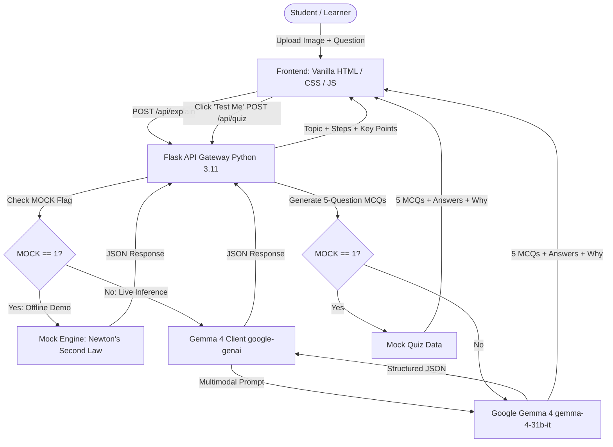

# DoubtLens 🔍⚡

> **Snap your doubt. Understand it. Test yourself.**  
> *Built for Hacktoberfest Hack Day Delhi × SKILLOP DTU (MLH)*

[](https://mlh.io)
[-4285F4?style=flat-square&logo=google)](https://ai.google.dev/gemma)
[](https://python.org)
[](https://flask.palletsprojects.com/)
[](LICENSE)
[](#-contributing--hacktoberfest)

---

<!-- LIVE DEMO URL PLACEHOLDER -->
> 🌐 **Live Demo URL**: `https://doubtlens.onrender.com` *(Replace with deployed URL)*

<!-- APP SCREENSHOT PLACEHOLDER -->
```
+-------------------------------------------------------------------------------+
|                            [ SCREENSHOT PLACEHOLDER ]                         |
|   Upload photo / diagram  ->  Step-by-step explanation  ->  "Test Me" Quiz     |
|                      |
+-------------------------------------------------------------------------------+
```

---

## 💡 Problem

Students frequently get stuck while solving complex problems from textbooks, handwritten notes, lecture slides, or diagrams. Existing search tools and generic chatbots often fail in critical ways:
- **No visual comprehension**: Inability to interpret handwritten math, circuit diagrams, chemical structures, or geometry figures.
- **Answer dumps without pedagogical reasoning**: Giving the final answer directly instead of teaching how to solve it step by step.
- **Language barriers**: High-quality STEM explanations are rarely available in vernacular languages like Hindi.
- **No retention check**: Students read an explanation passively but have no immediate way to test if they actually grasped the core concept.

---

## ✨ Features

- 📸 **Multimodal Input**: Upload a photo of a textbook page, handwritten calculation, or diagram (PNG, JPG, WebP up to 5 MB), or type any question directly.
- 🪜 **Step-by-Step Breakdown**: Deconstructs every problem into numbered, intuitive logical steps with highlighted key takeaways.
- 🌐 **Bilingual Explanations**: Seamless switching between **English** and **Hindi** (`language: "en" | "hi"`).
- 🎚️ **Dual Depth Modes**: Choose between `simple` (intuitive intuition-first summary) and `detailed` (rigorous derivations and edge cases).
- 🧠 **"Test Me" Mastery Quiz**: One-click generation of a diagnostic 5-question multiple-choice quiz derived from the specific doubt, complete with immediate answer checking and explanations (`why`).
- ⚡ **Zero-Bloat Frontend**: Handcrafted Vanilla HTML/CSS/JS with zero client-side frameworks or heavy npm dependencies. Blazing fast on mobile and low-bandwidth connections.
- 🧪 **Offline Mock Engine**: Set `MOCK=1` to test the entire application locally or demonstrate during hackathon judging with zero API key configuration.

---

## 🤖 How Gemma 4 is Used

DoubtLens targets the **Best Use of Gemma 4** prize category by making Gemma 4 the cognitive core of the learning loop:

1. **Multimodal Visual Reasoning**: Gemma 4 natively inspects uploaded textbook pages, handwritten scratch work, and scientific diagrams alongside the user's typed question via Google's `google-genai` SDK.
2. **Pedagogical Explanation Generation**: Using tailored system instructions, Gemma 4 structures explanations into a concise topic summary, sequential steps, and core retention points in either English or Hindi.
3. **Structured Diagnostic Quiz Generation**: When the student clicks "Test Me", Gemma 4 synthesizes exactly 5 multiple-choice questions specifically targeting misconceptions related to that exact topic, providing 4 options, the correct answer index, and a pedagogical "why" explanation.
4. **Configurable Model Name (Cloud or Self-Hosted)**: The model is configurable via the `GEMMA_MODEL` environment variable (defaults to `gemma-4-31b-it`). This allows DoubtLens to run seamlessly against Google Gemini API or against a self-hosted Gemma 4 instance (e.g. via vLLM or Ollama with an OpenAI-compatible gateway) without any code modifications.

---

## 🏗️ Architecture



---

## ⚡ Local Setup (Under 6 Commands)

Get DoubtLens running locally in 5 simple commands:

```bash
# 1. Clone the repository
git clone https://github.com/Kaushik-1609/dtu-hackathon-project.git && cd dtu-hackathon-project

# 2. Create and activate a Python 3.11 virtual environment
python3 -m venv venv && source venv/bin/activate

# 3. Install dependencies
pip install -r requirements.txt

# 4. Copy template environment file
cp .env.example .env

# 5. Run the application (runs on http://localhost:5000)
python app.py
```

> **Tip for Instant Testing**: Set `MOCK=1` in `.env` to test the complete UI and quiz flow immediately without providing a Gemini API key! To use live Gemma 4, set `MOCK=0` and add your `GEMINI_API_KEY`.

---

## 📡 API Documentation

Frontend and backend communicate using same-origin relative URLs.

### 1. Health Check
```http
GET /api/health
```
**Response (200 OK):**
```json
{
  "status": "ok"
}
```

### 2. Explain Concept / Problem
```http
POST /api/explain
Content-Type: multipart/form-data
```
**Form Fields:**
- `image` *(file, optional)*: Image file (`png`, `jpg`, `jpeg`, `webp`, max 5 MB).
- `question` *(text, optional)*: Typed problem text or doubt context.
  *(At least one of `image` or `question` is required)*.
- `language` *(text, optional)*: `"en"` (default) or `"hi"`.
- `level` *(text, optional)*: `"simple"` (default) or `"detailed"`.

**Response (200 OK):**
```json
{
  "topic": "Newton's Second Law of Motion",
  "explanation": "Newton's Second Law describes how the velocity of an object changes when it is subjected to an external force...",
  "steps": [
    "Step 1: Identify given forces and mass.",
    "Step 2: Formulate F = m * a.",
    "Step 3: Resolve vector components along the axis of acceleration.",
    "Step 4: Solve for the unknown acceleration."
  ],
  "key_points": [
    "Force is directly proportional to acceleration.",
    "Mass resists changes in acceleration.",
    "SI unit of force is the Newton (N = kg*m/s^2)."
  ]
}
```

### 3. Generate Mastery Quiz
```http
POST /api/quiz
Content-Type: application/json
```
**Request Body:**
```json
{
  "topic": "Newton's Second Law of Motion",
  "explanation": "Newton's Second Law describes how the velocity...",
  "language": "en"
}
```
**Response (200 OK):**
```json
{
  "questions": [
    {
      "q": "What happens to acceleration if net force is doubled and mass remains constant?",
      "options": [
        "Acceleration is halved",
        "Acceleration is doubled",
        "Acceleration remains the same",
        "Acceleration quadruples"
      ],
      "answer_index": 1,
      "why": "According to F = ma, acceleration is directly proportional to force."
    }
  ]
}
```

### Standard Error Format
All endpoints return consistent JSON error objects on failure:
```json
{
  "error": "Human readable error description"
}
```
- `400 Bad Request`: Neither image nor question provided, or invalid JSON payload.
- `413 Payload Too Large`: Uploaded image exceeds 5 MB.
- `500 Internal Server Error`: AI inference or server failure.

---

## 📁 Project Structure

```
doubtlens/
├── app.py                     # Flask application & route handlers (Mayank)
├── gemma_client.py            # Gemma 4 multimodal client & prompts (Mayank)
├── templates/
│   └── index.html             # Clean, responsive HTML UI (Harsh)
├── static/
│   ├── style.css              # Custom responsive stylesheet (Harsh)
│   └── app.js                 # Frontend interactions & API bindings (Harsh)
├── requirements.txt           # Python dependencies (Kaushik)
├── .env.example               # Template environment configuration (Kaushik)
├── .gitignore                 # Secrets, bytecode & venv exclusions (Kaushik)
├── Dockerfile                 # Python 3.11 container specification (Kaushik)
├── Procfile                   # Cloud web process entrypoint (Kaushik)
├── README.md                  # Complete project documentation (Kaushik)
├── LICENSE                    # Permissive MIT License (Kaushik)
├── samples/                   # Sample problem images & questions (Utkarsh)
│   └── .gitkeep
└── docs/                      # Technical references & architecture docs (Utkarsh)
    └── .gitkeep
```

---

## 🚀 Step-by-Step Cloud Deployment

### A. Deploy on Render (Recommended)

1. **Create a New Web Service**:
   - Go to the [Render Dashboard](https://dashboard.render.com/) and click **New + > Web Service**.
   - Connect your GitHub repository: `https://github.com/Kaushik-1609/dtu-hackathon-project`.
2. **Configure Settings**:
   - **Name**: `doubtlens`
   - **Environment**: `Python 3`
   - **Region**: Closest to your users (e.g., Singapore or Frankfurt)
   - **Branch**: `main` (or your active branch `hkg-kaushik`)
   - **Build Command**:
     ```bash
     pip install -r requirements.txt
     ```
   - **Start Command**:
     ```bash
     gunicorn app:app --bind 0.0.0.0:$PORT --timeout 120
     ```
3. **Add Environment Variables**:
   In the **Environment** tab on the Render service dashboard, click **Add Environment Variable**:
   - `GEMINI_API_KEY` = `your_actual_gemini_api_key` *(or leave blank if running in Mock mode)*
   - `GEMMA_MODEL` = `gemma-4-31b-it`
   - `PORT` = `5000` *(Render will automatically override $PORT dynamically)*
   - `MOCK` = `0` *(or `1` for demo mode without API keys)*
4. **Deploy**:
   - Click **Create Web Service**. Render will install dependencies, launch Gunicorn, and expose your live URL!

---

### B. Alternative: Deploy on DigitalOcean App Platform

1. In the [DigitalOcean Cloud Console](https://cloud.digitalocean.com/apps), click **Create App** and select **GitHub**.
2. Select repository `Kaushik-1609/dtu-hackathon-project` and branch `main`.
3. Set the **Component Type** to **Web Service**:
   - **Build Command**: `pip install -r requirements.txt`
   - **Run Command**: `gunicorn app:app --bind 0.0.0.0:$PORT --timeout 120`
   - **HTTP Port**: `5000`
4. Under **Environment Variables**, add:
   - `GEMINI_API_KEY`: *(encrypt as Secret)*
   - `GEMMA_MODEL`: `gemma-4-31b-it`
   - `MOCK`: `0`
5. Click **Next** and **Create Resources**.

---

## 🗺️ Roadmap

- [ ] **Vernacular Expansion**: Expand explanation and quiz generation to Tamil, Telugu, Bengali, Marathi, and Punjabi.
- [ ] **Flashcards & Anki Export**: One-click export of key points and quiz questions directly to downloadable `.apkg` flashcards.
- [ ] **Student Mastery Tracking**: LocalStorage-based dashboard tracking weak topics, quiz accuracy scores, and spaced repetition reminders.
- [ ] **Equation LaTeX Rendering**: Native lightweight KaTeX rendering for complex mathematical notation.

---

## 👥 Hackathon Team Ownership

Built with passion in 3 hours by:

| Member | Role | Primary Responsibility |
| :--- | :--- | :--- |
| **Mayank** | AI & Backend Lead | Flask endpoints (`app.py`), Gemma 4 multimodal client (`gemma_client.py`) |
| **Harsh** | Frontend Lead | User interface (`index.html`), styles (`style.css`), interactions (`app.js`) |
| **Kaushik** | DevOps & Architecture | `requirements.txt`, `.env.example`, `Dockerfile`, `Procfile`, `README.md`, `LICENSE` |
| **Utkarsh** | QA & Documentation | Test problem sets (`samples/*`), technical documentation (`docs/*`) |

---

## 🤝 Contributing & Hacktoberfest

Contributions are warmly welcomed for Hacktoberfest!

1. Fork the repo and create your branch: `git checkout -b feature/your-feature-name`
2. Keep code simple, clean, and well-commented.
3. Adhere to our zero-frontend-framework policy (pure Vanilla HTML/CSS/JS).
4. Verify tests pass and frozen API contracts are maintained.
5. Submit a descriptive Pull Request!

Check out our documentation files in [docs/](docs/) for deep dives.

---

## 🏷️ 5 "Good First Issue" Ideas for Contributors

Looking to make your first Hacktoberfest contribution? Here are 5 beginner-friendly issues ready to be implemented:

1. **`good first issue` #1: Add Dark / Light Mode Toggle**  
   *Description*: Implement a clean theme switch in `static/style.css` and `static/app.js` using CSS variables and persist the user's preference in `localStorage`.

2. **`good first issue` #2: Drag-and-Drop Image Upload Zone**  
   *Description*: Enhance the image upload area in `index.html` with a visual drag-and-drop zone that highlights on dragover and previews the selected image thumbnail.

3. **`good first issue` #3: One-Click Copy Explanation to Clipboard**  
   *Description*: Add a "Copy Explanation" button next to the explanation cards that copies formatted markdown/text to the clipboard with a subtle "Copied!" tooltip.

4. **`good first issue` #4: Export Quiz & Summary to Printable PDF / Markdown**  
   *Description*: Add an export action that generates a clean, printable study sheet with the topic explanation, key points, and quiz questions.

5. **`good first issue` #5: Quick-Start Example Doubt Buttons**  
   *Description*: Add 3 clickable pill buttons below the input box (e.g. *"Newton's 2nd Law"*, *"Photosynthesis Reaction"*, *"Ohm's Law"*) that pre-populate the question for immediate one-click testing.

---

## 📄 License

This project is open-source software licensed under the **[MIT License](LICENSE)**.
