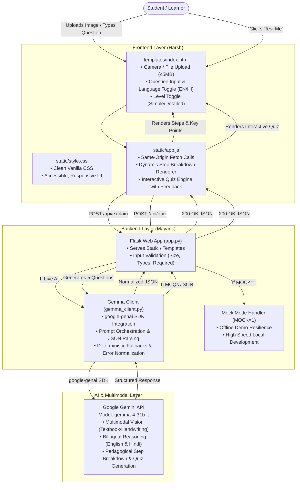

# DoubtLens Architecture & System Design

**DoubtLens** is an open-source, multimodal AI learning assistant built for **Hacktoberfest Hack Day Delhi x SKILLOP DTU (MLH)**. It bridges the gap between complex textbook/handwritten problems and conceptual mastery by combining **Google Gemma 4 (`gemma-4-31b-it`)** with step-by-step pedagogical explanations (English/Hindi) and an instant 5-question self-assessment quiz.

---

## 🏛️ High-Level System Architecture



---

## 🧩 Architectural Components & Division of Ownership

To ensure rapid, collision-free delivery in a 3-hour hackathon, DoubtLens enforces a modular codebase divided among 4 engineers:

| Component | Owner | Files | Responsibilities |
|---|---|---|---|
| **Core AI & Backend** | **Mayank** | `app.py`, `gemma_client.py` | Flask endpoints, request routing, `google-genai` integration, multimodal payload handling, error codes (400, 413, 500), `MOCK=1` handling. |
| **User Interface** | **Harsh** | `templates/index.html`, `static/style.css`, `static/app.js` | Zero-framework frontend, responsive UI, drag-and-drop file upload, language selector (English/Hindi), step-by-step accordion/cards, interactive quiz UI. |
| **DevOps & Packaging** | **Kaushik** | `requirements.txt`, `.env.example`, `.gitignore`, `Dockerfile`, `Procfile`, `README.md`, `LICENSE` | Containerization, deployment manifest for Gunicorn, dependency pinning, environment variable specification, open-source licensing. |
| **Samples, Quality & Docs** | **Utkarsh** | `samples/*`, `docs/*` | Sample datasets (images, questions), automated API contract test suites (`test_api.sh`, `test_runner.py`), architectural documentation, pitch guide, and Gemma 4 integration specs. |

---

## 🔄 End-to-End Data Flow

### 1. Explain Pipeline (`POST /api/explain`)
1. **Input Ingestion**: The student selects an image (`.png`, `.jpg`, `.webp` up to 5 MB) and/or enters a doubt in the text input.
2. **Client Validation**: `static/app.js` checks that at least one input is provided and that the file size is $\le 5\text{ MB}$.
3. **Backend Validation**: `app.py` checks:
   - If neither `image` nor `question` is supplied $\rightarrow$ returns HTTP `400 Bad Request` with `{"error": "At least one of image or question is required."}`.
   - If `image` exceeds 5 MB $\rightarrow$ returns HTTP `413 Payload Too Large`.
4. **Execution Mode**:
   - If `MOCK=1`: Returns pre-canned deterministic response for "Newton's Second Law" (in English or Hindi).
   - If Live: Passes image bytes and question to `gemma_client.py`.
5. **Gemma 4 Invocation**:
   - Formulates a system-instructed prompt requesting structured JSON output:
     `{"topic": str, "explanation": str, "steps": [str], "key_points": [str]}`.
   - Instructs the model to explain step-by-step in the target language (`en` or `hi`) at the requested pedagogical level (`simple` or `detailed`).
6. **Response Delivery**: Returns HTTP 200 with the exact contract payload.

### 2. Quiz Generation Pipeline (`POST /api/quiz`)
1. **Trigger**: After reviewing the explanation, the student clicks **"Test me"**.
2. **Payload Submission**: `static/app.js` sends:
   ```json
   {
     "topic": "<extracted topic>",
     "explanation": "<generated explanation>",
     "language": "en" | "hi"
   }
   ```
3. **Question Formulation**: `gemma_client.py` instructs Gemma 4 to formulate **exactly 5 multiple-choice questions** strictly grounded in the topic and explanation.
4. **Schema Enforcement**:
   - Each question has: `q` (string), `options` (array of exactly 4 strings), `answer_index` (integer from 0 to 3), and `why` (concise one-line rationale).
5. **Interactive Client Engine**:
   - The user selects an option.
   - Instant visual feedback: Correct option highlighted green; incorrect option highlighted red with the "why" explanation revealed.
   - Final score calculated upon completing all 5 questions.

---

## 🛡️ Reliability & Resilience Architecture

### 1. Zero External Runtime Dependencies on Frontend
- No external JS frameworks (no React, Vue, jQuery, or Tailwind).
- Plain HTML5, Vanilla CSS, and Modern JavaScript.
- Avoids CDN downtime or bundle compilation delays during judging.

### 2. Deterministic Mock Mode (`MOCK=1`)
- Built specifically for hackathon resilience:
  - If conference Wi-Fi fails or Gemini API rate limits are encountered during live judging, toggling `MOCK=1` allows the entire user journey to execute flawlessly with realistic Newton's Second Law data.
  - Allows frontend, documentation, and QA engineers to develop concurrently without requiring active API credentials.

### 3. Strict Contract Isolation
- Frontend communicates with backend exclusively through relative paths (`/api/explain`, `/api/quiz`, `/api/health`).
- Eliminates CORS issues in production by running backend and frontend on the same origin via Flask.
