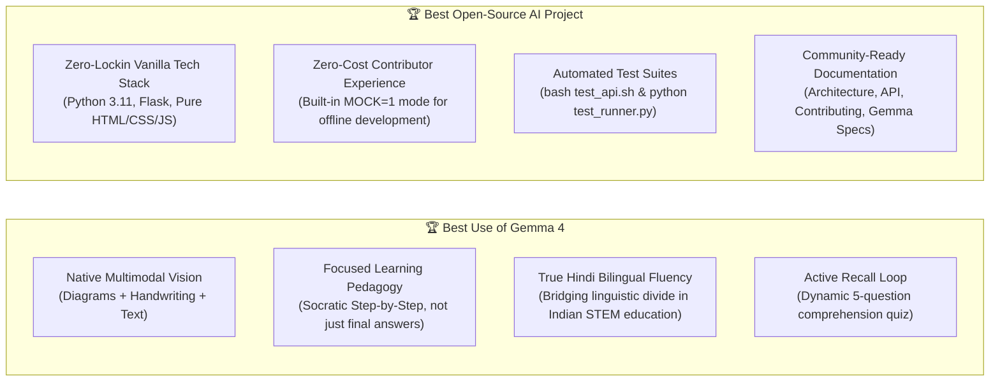

# DoubtLens 3-Minute Hackathon Pitch & Demo Guide

**Event**: Hacktoberfest Hack Day Delhi x SKILLOP DTU (MLH)  
**Target Prizes**:
1. 🏆 **Best Use of Gemma 4** (Multimodal Image + Text via Gemini API; focused AI tool for learning)
2. 🏆 **Best Open-Source AI Project** (Clean architecture, zero lock-in, reproducible setup)

---

## ⏱️ The 3-Minute Pitch Script

### [0:00 - 0:30] Hook & Problem Statement
> *"Judges, every single night in India, millions of students studying for JEE, NEET, or university exams get stuck on a tricky physics diagram or handwritten calculus problem at 11 PM. Private tutors are expensive, forums take hours to respond, and generic AI chatbots often spit out confusing walls of text or skip critical algebraic steps. Even worse, over 60% of students struggle to understand complex STEM explanations in English."*

### [0:30 - 1:15] The DoubtLens Solution & Gemma 4
> *"Introducing **DoubtLens**—your multimodal, open-source AI study companion powered by **Google Gemma 4 (`gemma-4-31b-it`)**.  
> A student simply snaps a photo of their textbook page, handwritten notebook, or schematic diagram, and asks their doubt in either **English or Hindi**.  
> Gemma 4 doesn't just give an answer—it breaks the solution down into **pedagogical, bite-sized steps** with core key points and intuitive takeaways."*

### [1:15 - 2:00] Live Multimodal Demo
> *(Presenters demonstrate in the UI)*
> 1. *"Watch this: We upload a real physics textbook problem with a Free Body Diagram—a 5kg block pulled by 20N with 5N friction."*
> 2. *"We select **Hindi** and **Simple** mode, then hit Explain."*
> 3. *"In seconds, Gemma 4 parses the force vectors in the diagram, calculates the net force ($15\text{ N}$), divides by mass, and delivers a crystal-clear 4-step explanation in fluent Devanagari Hindi!"*
> 4. *"Now, how do we know the student actually learned it? Click **'Test me'**!"*
> 5. *"Gemma 4 dynamically synthesizes an interactive 5-question multiple-choice quiz grounded in the exact problem. When we choose an answer, we get instant feedback with a one-line rationale explaining why it's correct or incorrect."*

### [2:00 - 2:35] Why DoubtLens Wins Both Prizes
> *"Why does DoubtLens win **Best Use of Gemma 4**?  
> Because it's not a generic wrapper—it leverages Gemma 4's native multimodal vision to understand handwritten equations and vector diagrams, coupled with Gemma's bilingual Hindi reasoning to solve educational inequity.  
> And why **Best Open-Source AI Project**?  
> Our frontend has **zero external frameworks**—pure, blazing-fast HTML, CSS, and JS. Our backend is lightweight Flask with pinned dependencies. We built a fully deterministic `MOCK=1` mode so any student or contributor worldwide can run and hack on DoubtLens locally without spending a dime on API keys."*

### [2:35 - 3:00] Closing & Vision
> *"DoubtLens turns every smartphone into a 24/7 personal STEM tutor for every student, regardless of their native language or economic background. Thank you, and we'd love to take your questions!"*

---

## 📋 Live Demo Checklist for Presenters

| Step | Action | Expected Output | Backup if Wi-Fi Drops |
|---|---|---|---|
| **1. Health Check** | Ensure server is running (`npm`/`flask run` on port 5000) | Webpage loads instantly at `http://localhost:5000` | Works offline |
| **2. Multimodal Upload** | Click Upload $\rightarrow$ select [`samples/physics_newton_law.jpg`](../samples/physics_newton_law.jpg) | Preview shows diagram of block with 20N pull and 5N friction | Preloaded in `samples/` |
| **3. Hindi Toggle** | Select **Hindi (`hi`)** from the language dropdown | UI language switches to Hindi | Instant |
| **4. Click Explain** | Click "Explain Doubt" | Gemma 4 outputs Topic, Overview, 4 Steps, and 3 Key Points in Hindi | `MOCK=1` returns instant Newton's Law in Hindi |
| **5. Test Me Quiz** | Click "Test me" button below the explanation | Generates 5 interactive MCQs | `MOCK=1` returns 5 questions with feedback |
| **6. Interactive Answer** | Click an answer option on Q1 | Instant green/red border feedback with "Why" explanation | Instant client-side validation |

---

## 🎯 Prize Target Alignment Matrix

---

## 🙋 Anticipated Judge Questions & Winning Responses

### Q1: *"Why did you choose Gemma 4 instead of Gemini 1.5 Pro or standard GPT-4?"*
> **Answer**: *"Gemma 4 is an open-weights model family that offers unmatched transparency and privacy for educational tools. By optimizing for `gemma-4-31b-it`, we achieve low latency and exceptional STEM multimodal reasoning at a fraction of the inference cost, making it viable for free, open-source deployment in classrooms."*

### Q2: *"How do you prevent the AI from hallucinating incorrect steps in math or physics?"*
> **Answer**: *"We apply three techniques:  
> 1. Low temperature (`0.2`) for mathematical determinism.  
> 2. Strict system instruction requiring an intermediate force-identification step before calculating numbers.  
> 3. The 'Test Me' quiz acts as a reinforcement check, grounding questions strictly in the verified explanation."*

### Q3: *"How does the Hindi translation perform on technical terms?"*
> **Answer**: *"Rather than using standard English transliteration (Hinglish), Gemma 4 generates authentic Devanagari Hindi while preserving standard scientific vocabulary (like त्वरण for acceleration and न्यूटन for force units), matching the NCERT curriculum used by millions of Indian students."*

### Q4: *"What happens if a student has low internet connectivity?"*
> **Answer**: *"Because our frontend uses zero heavy JavaScript frameworks (under 20 KB total payload), the app loads instantly even on 2G/3G connections. The backend enforces a 5 MB image limit and compresses request payloads to ensure minimal bandwidth consumption."*
